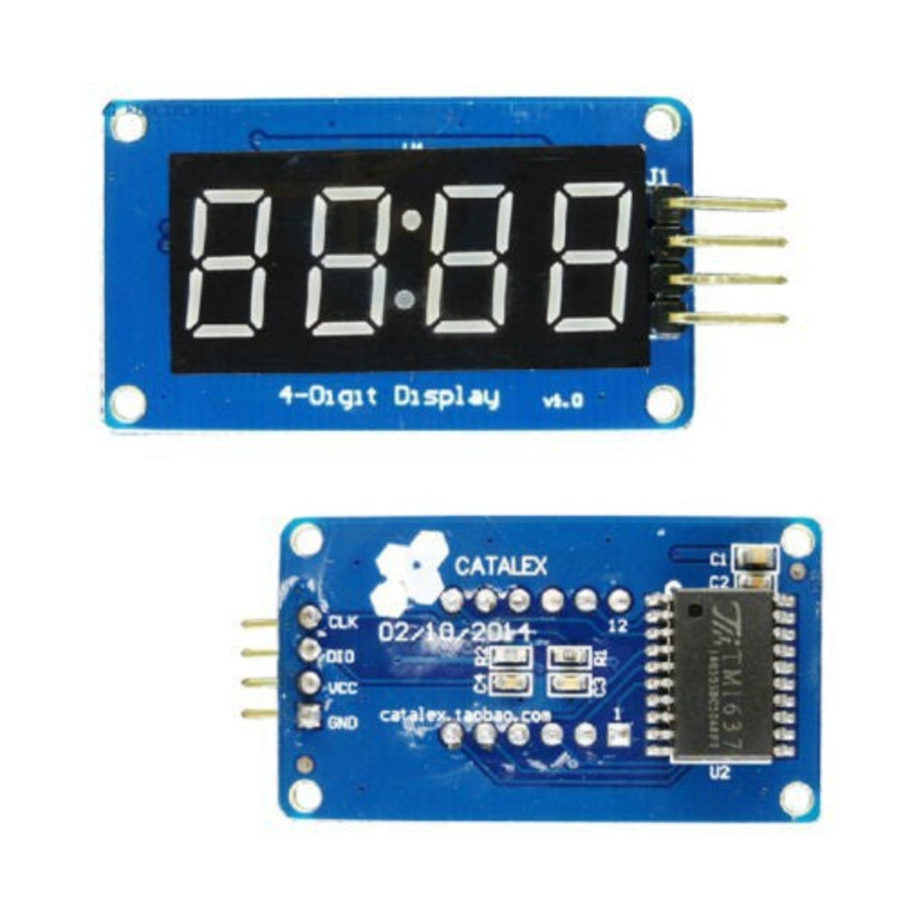
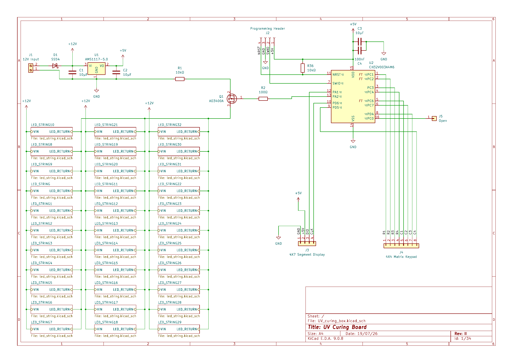
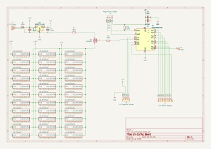
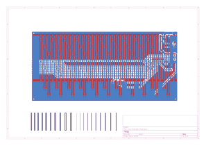
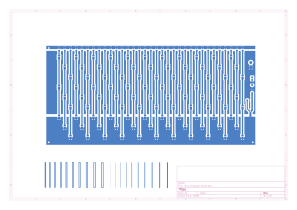
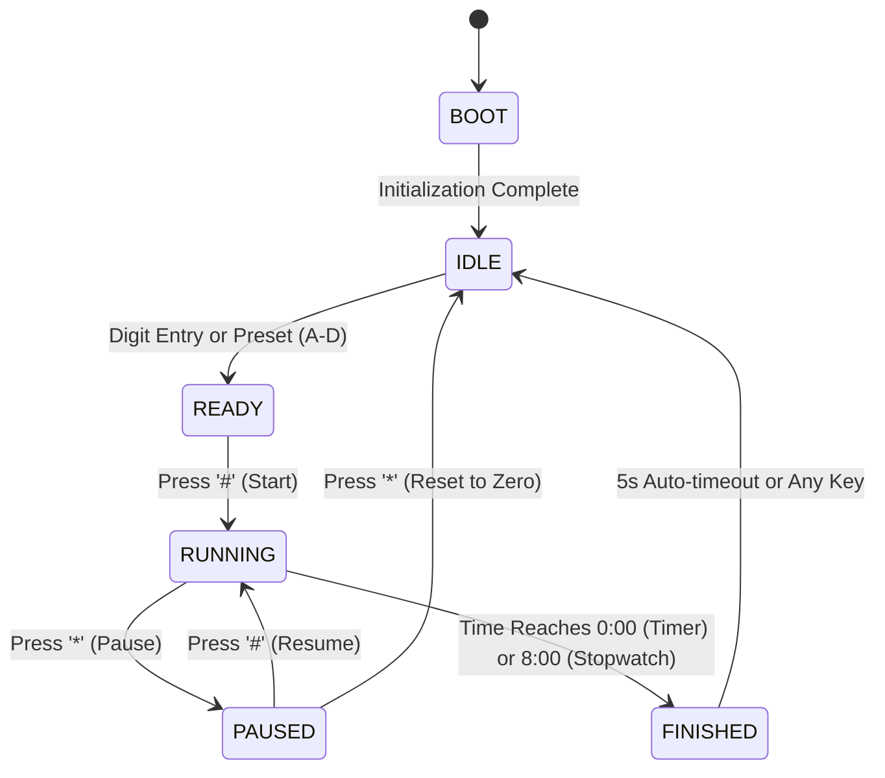

# UV PCB Curing Box

A dedicated, safety-interlocked UV exposure and resin curing chamber controller powered by the ultra-low-cost WCH CH32V003 RISC-V microcontroller, featuring a 4x4 matrix keypad, a 4-digit TM1637 7-segment display, software PWM brightness control, and custom KiCad hardware.

---

## Features

- **RISC-V Microcontroller Core**:
  - Implemented on the WCH CH32V003A4M6 (QingKe 32-bit RISC-V2A core @ 48 MHz, 16 KB Flash, 2 KB SRAM).
  - Built with the PlatformIO Community CH32V Arduino core (`ch32v003fun` HAL).
- **Fail-Safe UV Safety Interlocking**:
  - The high-power UV LED MOSFET (pin A2) is strictly energized ONLY during the active `RUNNING` state.
  - Transitions to `BOOT`, `IDLE`, `READY`, `PAUSED`, or `FINISHED` instantly and continuously force the gate LOW.
- **Dual Timing Modes**:
  - **Timer Mode**: Countdown timer with customizable duration (capped at 8:00 minutes) and automated shutoff.
  - **Stopwatch Mode**: Elapsed time counter with live LED toggling.
- **Fast Presets & Matrix Keypad Input**:
  - 4x4 matrix keypad interface for direct numeric entry, pause/resume, and reset.
  - One-touch curing duration presets:
    - **A**: 1:00 min
    - **B**: 1:30 min
    - **C**: 2:00 min
    - **D**: 3:00 min
  - On-the-fly cycle extension (`#` button adds +5 seconds, clamped to 8:00).
- **PWM Exposure Brightness Regulation**:
  - 50 Hz sampled software PWM (0–100%) designed to eliminate flicker and ensure accurate optical dose delivery.
  - Dedicated on-screen brightness tuning menu (`b 0` to `b100`).
- **Telemetry & Status Display**:
  - TM1637 4-digit 7-segment display showing MM:SS with blinking colon indicators during exposure.
- **Custom Hardware & PCB**:
  - Designed in KiCad with full schematics, PCB routing, 3D step models, and vector silkscreens.

---

## Hardware Specification

### Components & Microcontroller
- **MCU**: WCH CH32V003A4M6 (TSSOP-20).
- **Display**: TM1637 4-digit 0.36" / 0.56" 7-segment clock display module.
- **Keypad**: 4x4 tactile matrix keypad.
- **Switching MOSFET**: N-Channel Power MOSFET (low-side switch on A2 driving 395nm/405nm UV LED arrays).
- **Power Input**: 12V DC input for LED strings with onboard 5V / 3.3V LDO regulation for logic.

---

## Hardware Prototype & Visual Design

### Live Hardware Prototype
Below is the operational controller prototype executing a countdown exposure on the TM1637 4-digit display:

<p align="center">
  
</p>

### Electrical Schematic

<p align="center">
  
</p>

### PCB Board Layout & Copper Routing

| Complete Board Layout | Top Copper Layer (`F_Cu`) | Bottom Copper Layer (`B_Cu`) |
| :---: | :---: | :---: |
|  |  |  |

---

### Pinout Mapping

| Function | Pin Name | Direction | Description |
| :--- | :--- | :--- | :--- |
| **Keypad Row 1** | C1 | Output | Matrix row scan line 1 |
| **Keypad Row 2** | C2 | Output | Matrix row scan line 2 |
| **Keypad Row 3** | C3 | Output | Matrix row scan line 3 |
| **Keypad Row 4** | C4 | Output | Matrix row scan line 4 |
| **Keypad Col 1** | C6 | Input (Pullup)| Matrix column sense line 1 |
| **Keypad Col 2** | C7 | Input (Pullup)| Matrix column sense line 2 |
| **Keypad Col 3** | D4 | Input (Pullup)| Matrix column sense line 3 |
| **Keypad Col 4** | D5 | Input (Pullup)| Matrix column sense line 4 |
| **TM1637 CLK** | D6 | Output | Display serial clock |
| **TM1637 DIO** | A1 | Bidirectional| Display serial data line |
| **UV MOSFET Gate**| A2 | Output | Low-side power gate driver (PWM) |

---

## State Machine



---

## Project Structure

```text
UV-Curing-Box/
├── Programs/                         # PlatformIO firmware project
│   ├── platformio.ini                # CH32V003 target configuration
│   └── src/
│       └── main.cpp                  # Complete non-blocking state machine & firmware
├── Schematic.pdf                     # Schematic diagram export
├── UV_curing_box.kicad_sch           # KiCad schematic
├── UV_curing_box.kicad_pcb           # KiCad PCB board layout
├── MCU_WCH_CH32V003xxx6.kicad_sym   # Custom CH32V003 symbol library
├── led_string.kicad_sch              # UV LED array layout
├── UV_curing_box.svg                 # Scalable vector graphics board plot
├── .gitignore                        # Git ignore rules
└── README.md                         # Project documentation
```

---

## Firmware Compilation & Flashing

### Using PlatformIO (VS Code / CLI)
1. Install [PlatformIO Core](https://platformio.org/) and the Community CH32V platform:
   ```bash
   cd Programs
   pio run
   ```
2. Connect a **WCH-LinkE** programmer to the single-wire debug interface (SWDIO on pin D1, GND, 3V3).
3. Upload firmware:
   ```bash
   pio run --target upload
   ```

---

## License

Open hardware and embedded firmware. All rights reserved by the author.
